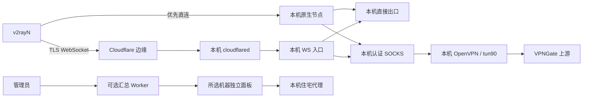

# 架构、文件职责与接口

## 数据流

汇总 Worker 只代理管理请求，不承载节点流量。代理从本机面板取配置、向本机面板汇报；汇总入口故障不会停止已有节点。CF 隧道故障会影响使用它的入口，直连入口不因此停止。

## 仓库文件

| 文件 | 职责 | 修改后 |
|---|---|---|
| src/install.sh | 预检、菜单、发现、补建、网络适配 | 重建 |
| src/update.sh | 面板/代理更新、内部 API、证书 | 重建 |
| src/preflight.sh | 每次安装的依赖补齐、TUN/权限/空间/DNS/时钟检查 | Bash 检查、重建 |
| cert-runtime.py | 自动准备证书 Python/Certbot、下载校验、失败原因记录 | 证书回归、重建 |
| jkyj.sh、gengxin.sh | 自包含发布入口 | 生成文件，勿直接改载荷 |
| discover-existing.py | 只读扫描活动 unit，恢复 Reality/HY2/住宅链接和面板 | 测发现逻辑、重建 |
| residential-panel.py | HTTPS 页面、认证 API、校验、住宅端口同步和回滚 | 测 API/TLS、重建 |
| panel-original.html | 原版页面，独立面板和汇总共用 | 浏览器检查、重建 |
| residential-agent.py | VPNGate 候选、OpenVPN、国家策略、上报、日志限额 | 测出口、重建 |
| residential-proxy.py | 本机认证 SOCKS，通过本机隧道出站 | 测未连通行为、重建 |
| network-adapter.py | 网络分类、防火墙、CF、DNS证书、优选、清理 | 测权限/生命周期、重建 |
| verify-node.py | 临时核心测试分享链接，无 v2rayN 配置修改 | 协议实测、重建 |
| xiezai.py、xiezai.sh | 归属检查、卸载、云清理；Bash 包装由构建生成 | 测卸载范围、重建 |
| hub/worker.js | 登录、一次性接入码、凭据加密、机器隔离及转发 | Node 测试、试验域名验收 |
| hub/panel.html | 原页面副本，运行时注入机器选择器 | 生成文件 |
| hub/schema.sql | 专用 D1 表，不修改旧表 | 备份后迁移 |
| hub/wrangler.example.toml | 无密钥、无生产路由的部署样例 | 复制为私有配置 |
| bootstrap/install.sh | 公共短入口，下载原安装器并自动判断 root/sudo | Bash 检查、模拟权限测试 |
| bootstrap/worker.js、wrangler.example.toml | 独立无绑定的 HTTPS 脚本分发服务与自部署样例 | Node 检查、单独部署；详见 BOOTSTRAP.md |
| scripts/build.py | 标准库构建器，内嵌源码与页面 | 每次源码修改后执行 |
| scripts/check.py | 语法、构建一致性、Python/Node 回归 | 发布前执行 |
| tests/ | 不改真实云的测试，以及显式选择的协议实测 | 随功能维护 |
| 新VPS一条命令.txt | 大体积自包含备用命令 | 构建生成 |

## VPS 路径与归属

下列文件在 /etc/residential-stack 中，均不应提交仓库。含授权的文件使用 600，目录使用 700。

| 文件 | 内容 |
|---|---|
| settings.json | 面板/内部 API 端口、住宅国家/策略、核心路径、证书路径、最终面板 URL |
| auth.json | 面板与 SOCKS 随机凭据 |
| network.json | 实例编号、模式、外部映射、WS 随机凭据、自己创建的云资源账本 |
| port-mappings.json | 通用平台映射交接表，内部端口由脚本填好，用户/平台工具填外部地址和端口；重跑自动读取 |
| cloudflare.json、tunnel.token、dns-credentials.ini | CF API、隧道、DNS 验证授权 |
| air.json | 可选 NVIDIA API 授权与明确的接口编号 |
| hub.json | 可选汇总 URL、机器编号、仅限自身的机器令牌；无管理员密码 |
| native-links.json | 原生入口候选，不能当作已验证清单 |
| deployment-details.txt | 完整诊断与端口说明；终端使用精简结果 |
| candidate-links.json | 本轮尝试的入口，包含节点凭据 |
| links.json | 本轮公开自测通过的入口 |
| network-report.json | 测试范围、结果、端口状态；generated_roles/ready_roles 分开，pending_panel_urls 不代表已可达；不含完整节点链接 |
| ws.json | loopback WS 入口及住宅路由 |
| firewall-ports.json | 本项目请求放行的协议与内部端口 |
| environment-report.json | 当次环境检测结果及限制，不含登录凭据 |
| certificate-status.json | 证书环境/申请/加载阶段及实际失败分类 |
| cert-runtime/ | 仅供证书使用的 uv、托管 Python 与缓存，随自有 stack 目录卸载 |
| cert-renew.lock | IP 证书手动申请与定时续期的互斥锁 |
| acme*、panel-*.pem、证书脚本 | 证书、独立 Certbot 数据与续期 |

| 其他路径 | 职责 |
|---|---|
| /etc/sing-box/three-nodes.json | 本项目原生入口，不替换原有节点服务 |
| /opt/residential-stack-agent | 自有代理、候选配置、有限大小日志 |
| /opt/residential-stack-bin | 自有 sing-box、可选 cloudflared，不替换系统程序 |
| /opt/residential-certbot | 独立证书虚拟环境 |
| /root/three-nodes-info.txt、three-nodes-links.txt | 中文结果与已生成链接复制区（可能尚未通过公网测试）；600 |
| /root/ip-install.XXXXXX.log | 每次安装的系统/下载/更新/本机检测及详细结果；root 私有，卸载后保留 |

native-links 与最终 links 分离，避免重复安装时把旧的隧道入口当作原生入口。诊断资料分享前须脱敏。

## 服务生命周期

| unit | 作用 | 重启条件 |
|---|---|---|
| three-nodes.service | 自有 Reality/HY2 原生入口 | 补建或修改配置 |
| residential-panel.service | 公开 HTTPS、内部 HTTP | 面板代码/内部接口/证书变化，或服务失活 |
| residential-agent.service | 住宅出口 | 代理代码/连接配置变化；无变化保留现有隧道 |
| residential-ws.service | 本机 WS 入口 | WS 配置/服务变化或失活 |
| residential-tunnel.service | 本机独立 named tunnel | 服务变化或失活；程序自行重连 |
| residential-firewall.service | 开机重放放行规则 | oneshot，不改默认策略 |
| residential-cert-renew.timer/service | 每 12 小时检查证书 | hook 只重启自有面板 |

自有住宅接口 tun90、策略路由表 190。卸载只删除能确认归属的规则，不全局结束 OpenVPN 或清空路由。

## 本机面板 API

所有接口要求 Basic 身份认证。公开入口 HTTPS；内部 HTTP 只监听 127.0.0.1。

| 接口 | 方法 | 职责 |
|---|---|---|
| /、/index.html | GET | 原页面，运行时替换地址/凭据占位符 |
| /api/config | GET | mode、manual_node_ip、proxy_port、slot_map、force_switch、检测/轮询选项 |
| /api/config | POST | 校验保存；住宅端口同时更新原生与 WS，校验/重启失败回滚 |
| /api/switch | POST | 修改换 IP 修订号，由本机代理轮询获取 |
| /api/report | POST | 代理上报候选、出口、有限长度日志 |
| /api/nodes | GET | 原页面需要的数组、details JSON 字符串、候选及日志 |
| /api/status | GET | 最近上报状态 |
| /api/countries | GET | 国家及候选中出现的国家 |
| /api/links | GET | 本轮通过的按角色链接 |
| /api/proxies | GET | 住宅入口分享链接 |

浏览器写入须有 X-Panel-Action: 1。/api/report 是代理兼容例外，仍需认证。以 Handler.do_POST 为校验依据：国家两个字母，端口 1–65535，手动 IP 为 IPv4，轮询有上下限；不能只在前端检查。

## 日志容量

- 浏览器实时日志替换刷新，保留约 24000 字符，不无限追加。
- manager.log、ovpn_err_0.log 每份约 256 KiB，超限保留尾部约 128 KiB。
- 上报日志约 12 KiB；状态 JSON 覆盖写。
- systemd journal 由操作系统另行管理，和上述限额无关。
- 汇总面板即时读取所选机器，不把所有运行日志复制进 D1。
